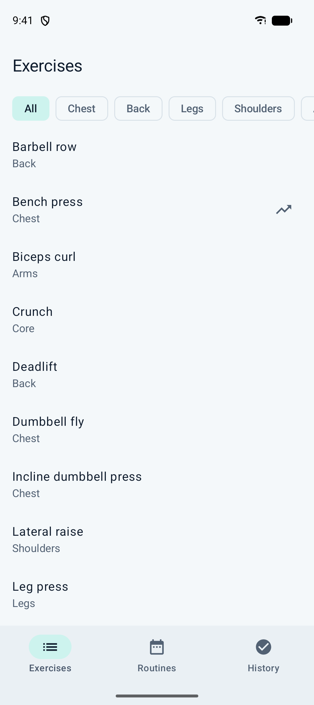
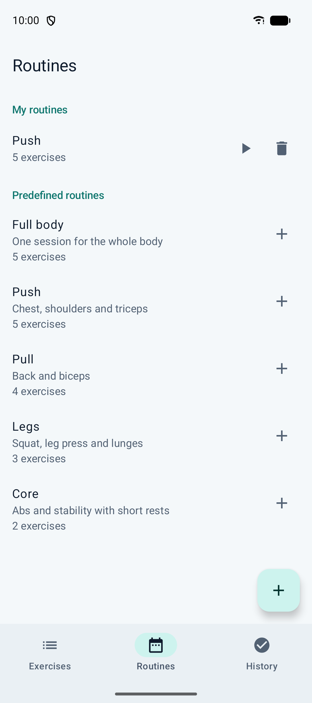
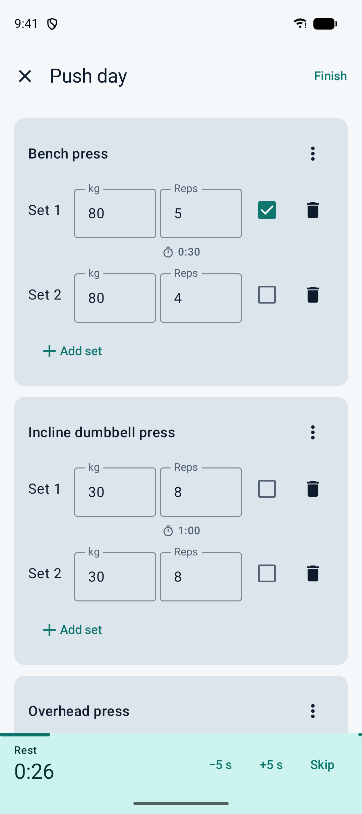
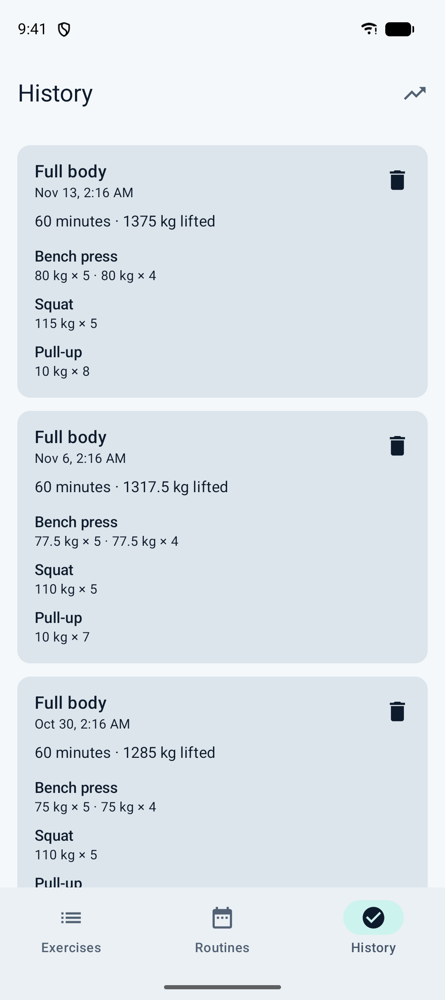
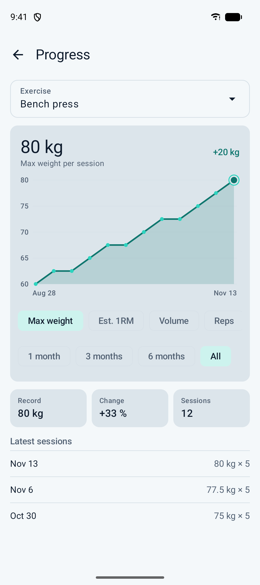
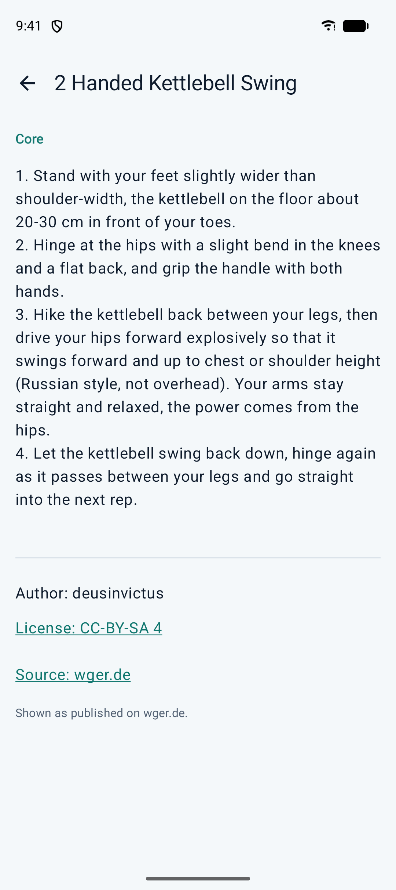
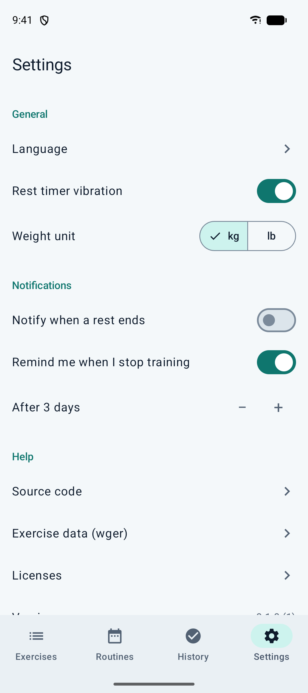
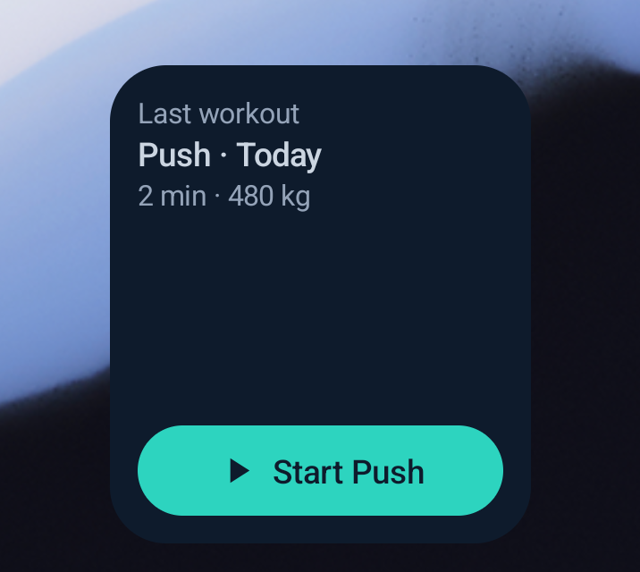
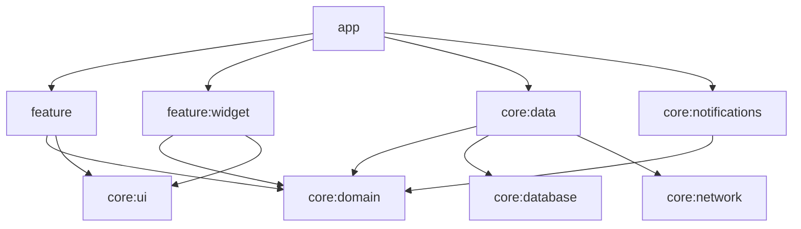

# Repzi

[](https://github.com/japl600/Repzi/actions/workflows/ci.yml)

A gym workout logger for Android. Build routines (your own, or predefined ones copied with a tap), log sets, reps and weight while you train, rest with a countdown, and watch your progress over time. It works offline, in English and Spanish, in kilograms or pounds.

It is also a portfolio project: a multi-module Clean Architecture app built with current Android tooling, developed test-first, with more than 500 tests that run in CI on every push.

## Screenshots

<p>
  
  
  
  
</p>
<p>
  
  
  
  
</p>

The workout data shown is sample data.

## What it does

- **Exercises.** The 15 built-ins plus about 900 exercises synced from [wger](https://wger.de), filtered by muscle group and searchable by name (ignoring case and accents). The detail screen shows the steps, the author and the license.
- **Routines.** Create, edit, reorder and delete your own, with a rest time per exercise. Predefined ones (full body, push, pull, legs, core) are templates copied into your routines.
- **Workout session.** Log sets, reps and weight. Ticking a set starts that exercise's rest countdown (adjustable, with a buzz when it ends). A workout in progress is saved as a draft and resumes after the app is closed.
- **History and progress.** Finished workouts with duration and volume, and a per-exercise chart (drawn on a Canvas) of max weight, estimated 1RM, volume or reps over 1, 3 or 6 months.
- **Settings.** Language, weight unit (kg / lb), rest vibration, notifications, open-source licenses, source code link.
- **Notifications.** A notice when a rest ends and a reminder after a few days without training (see below).
- **Home-screen widget.** A 2x2 Jetpack Glance widget shows your last workout and one button: it starts the routine that is up next (the one after your last, in the list's order), or resumes a workout you left unfinished. The button opens the workout through a deep link.

## Technical highlights

- **Offline-first.** Room is the single source of truth. The UI only reads from it; the network only feeds it.
- **MVI where it pays off.** The workout session is the most stateful screen, so it uses intents, a pure reducer and one-shot effects. The other screens use MVVM with a single UI state.
- **Process death and rotation.** The workout draft lives in Room, not in memory. Pending permission requests and dialogs use `rememberSaveable`, and there are tests that recreate the activity.
- **Correct time-based work.** The rest-over notice is an `AlarmManager` alarm (exact when allowed, approximate otherwise) so it arrives with the screen off. The inactivity check is a daily WorkManager job with a rule that sends one notice per lapse.
- **Data you can trust.** Weights are always stored in kilograms and only converted when typed or shown, so switching units never touches the data. Room migrations (schema v1 to v7) are exported and tested. The wger client skips one malformed record instead of dropping the whole page.
- **A widget that stays correct.** An app-side observer redraws it only when what it shows changes (typing in a workout rewrites the draft all the time, but the widget only cares that one exists), and the state is collected inside the widget's content, because Glance only recomposes an open session and does not run the setup code again. It also redraws when the app language changes and when an unfinished workout gets too old to resume, two things that never touch the database. The rule that picks the routine is a pure function with unit tests.
- **Localization.** `values-es` in every module; built-in exercises are stored with a stable key and translated when shown, so their names follow the app language, even when it changes while the app is open.
- **Build.** Gradle convention plugins in `build-logic`, a version catalog, and a CI that runs unit tests and the Compose and Room tests on an emulator.

## Architecture

Clean Architecture modularized by layer and by feature.



```
app                      composition root (Application, Activity, NavHost)
core/
  domain                 pure Kotlin: models, repository interfaces, use cases
  data                   offline-first repositories on top of Room and the weekly catalog sync (WorkManager)
  database               Room: entities, DAOs, migrations
  network                Retrofit client for the wger catalog (plain models, no HTTP types leak out)
  notifications          rest-over alarm and inactivity reminder: channels, permission checks, posting
  ui                     Material 3 theme and shared components
  testing                shared fakes and test rules
feature/
  exercises              catalog, search and detail
  routines               list, editor and predefined templates
  session                the workout in progress (MVI) and its draft
  history                finished workouts
  progress               per-exercise charts
  settings               preferences (Preferences DataStore), licenses, about
  widget                 the 2x2 Glance home-screen widget, its state rule and the updater
build-logic/convention   convention plugins (repzi.android.*, repzi.jvm.library)
```

Allowed dependencies: `feature` (every module under `feature/`, the widget included) → `core:domain` + `core:ui`; `core:data` → `core:domain` + `core:database` + `core:network`; `core:notifications` → `core:domain`; `app` knows everything in order to build the Hilt graph. `core:domain` has no Android dependencies, so it can be moved to Kotlin Multiplatform later.

## Stack

Kotlin, Coroutines and Flow, Jetpack Compose (Material 3, own teal/navy palette, no dynamic color), Hilt, Room, Preferences DataStore, Retrofit, OkHttp and kotlinx-serialization, WorkManager and AlarmManager, Navigation Compose, AboutLibraries. `minSdk` 26.

## Testing

About 340 unit tests (use cases, view models, reducers, mappers, the widget's rule and updater, the wger client against a mock server) and about 210 instrumented tests (Compose screens, Glance composition, deep-link navigation, alarms registered in the system, Room DAOs and migrations), TDD throughout. CI runs both on every push; the instrumented job runs on a small-screen emulator, which catches layouts that only fit on a big phone.

## Data and licenses

The exercise catalog comes from [wger](https://wger.de), an open-source fitness project. Every exercise is published under a Creative Commons license that depends on the exercise (CC-BY-SA 3.0, CC-BY-SA 4.0 or CC0 in the Spanish and English data used here), and its author and license are shown on the exercise detail screen. The share-alike licenses apply to that content: the exercise texts stay under their license inside the app. The license of the app code is not affected. The catalog is downloaded once a week on an unmetered network (about 2.3 MB) and stored in Room, so the app works offline; the wger API cannot be filtered by date, so each exercise's `last_update_global` is compared with the stored one and only changes are written.

Open-source libraries are listed in the app under Settings, Licenses.

## Notifications

Both are optional and off by default; the Android 13+ permission is asked when a switch is turned on, not at launch.

- **Rest over.** Ticking a set sets an `AlarmManager` alarm for the end of the rest, so the notification arrives with the screen off or the app minimized, and the alarm survives the app being swiped away on stock Android. It is exact when the user allows exact alarms and approximate otherwise (Settings says so); if the user allows them in the middle of a rest, that rest's alarm is set again as exact. It is not posted while the app is on screen, and some manufacturers' battery savers can still drop alarms.
- **Inactivity reminder.** A daily WorkManager check (around 18:00) notifies once when the chosen number of days (1 to 14, default 3) has passed since the last finished workout. It sends one notice per lapse and nothing before the first workout.

## Getting started

1. Open the project folder in Android Studio and wait for the Gradle sync (JDK 17 or newer; CI uses Temurin 21).
2. Run the `app` configuration on an emulator or device.
3. Tests: `./gradlew test` (unit tests) and `./gradlew connectedDebugAndroidTest` (Compose screen tests and Room DAOs/migrations; needs an emulator or device, and it erases the app's data there).

## Roadmap

- **Done:** exercise library, custom and predefined routines, workout logging with a rest timer, history, progress charts, search, remote catalog with background sync, notifications, English and Spanish, kg / lb, a home-screen widget.
- **Next:** a second widget with the week's summary (workouts per day and volume against last week).
- **Later:** a foreground service with a live rest countdown in the notification (evaluated, not built), Baseline Profiles and Macrobenchmark with measured build and startup times, screenshot tests, migrating `core:domain` and `core:data` to Kotlin Multiplatform.
